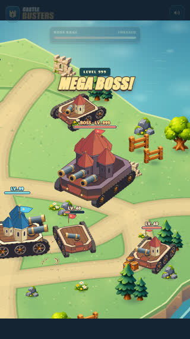

# Castle Busters | HTML5 Playable Ad

> **Non-commercial test assignment.** I created this playable as a test assignment and share it here for portfolio review. It generates no revenue for me.

**[Play Castle Busters in your browser](https://dekmer.github.io/castle-busters-playable-ads/)**

Steer a castle on tracks, knock apart roaming fortresses and collect the gold and timber that fly back to your deck. Each upgrade changes your silhouette. At level 99, you can draw out the level 999 boss.

  

<a href="media/gameplay.mp4"><strong>Watch 30 seconds of gameplay</strong></a>

## Play offline

Download [index.html](index.html) using GitHub's **Download raw file** button, then open it in your browser. The entire game fits in **790 KB**, including the art, music and sound effects, and runs offline.

| Action | Control |
| --- | --- |
| Steer | Drag on the screen or use WASD or the arrow keys |
| Fire | Cannons aim and shoot automatically when an enemy is in range |
| Upgrade | Collect gold and timber, then tap **Upgrade** |
| Play again | Tap **Retry** after the battle |

## Playable ad concept

The opening is deliberately meditative. You steer, the cannons fire on their own, and gold and timber fly back to your castle. Each upgrade gives that rhythm a payoff you can see: your level jumps from 1 to 10, then 50 and 99, and a second cannon joins the fight.

The level 999 boss breaks that rhythm. Its final attack destroys your castle and leaves the boss at **20% health**. That last sliver of health is the hook: the loss feels close enough to make you wonder what you would do on another run. The intended ad uses **Retry** to take that impulse to the game's store page. In this portfolio demo, **Retry** starts a fresh battle.

## From Unity prototype to HTML5

Unity is my main development environment, so I built and coded the first prototype there using primitive shapes to test movement, combat and upgrade pacing. To fit the playable within a **5 MB** budget, I used generative AI to port the prototype and rewrite its gameplay in TypeScript for HTML5 Canvas. The browser build ships as a single 790 KB HTML file.

I also used generative AI to create the artwork from scratch because no art assets were supplied. The final render combines those sprites with Canvas-drawn parts so the hull, tracks and turrets turn together.

## Credits

Music by Emma_MA. The game and video use an excerpt of [Determined Pursuit](https://opengameart.org/content/determined-pursuit-epic-orchestra-loop), released under [CC0 1.0 Universal](https://creativecommons.org/publicdomain/zero/1.0/).
